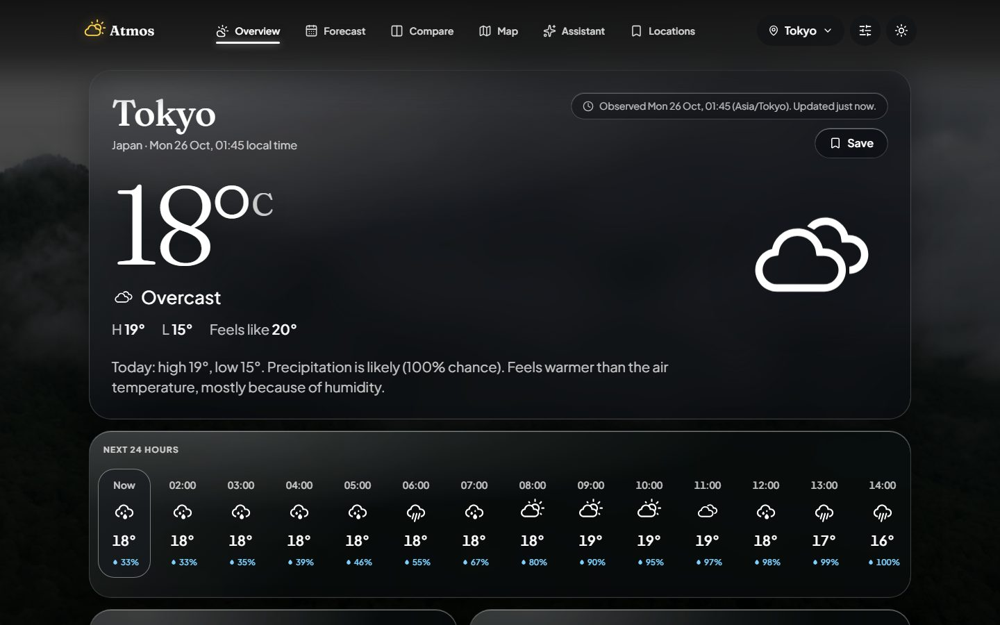
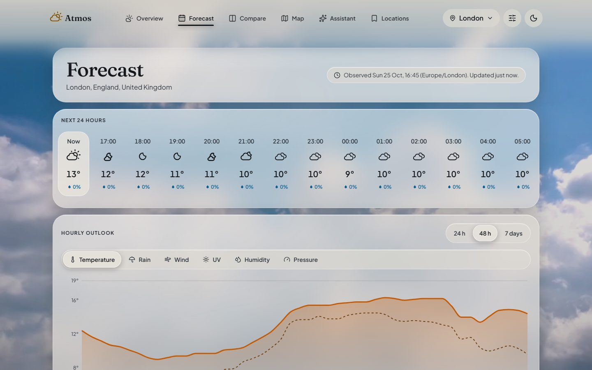
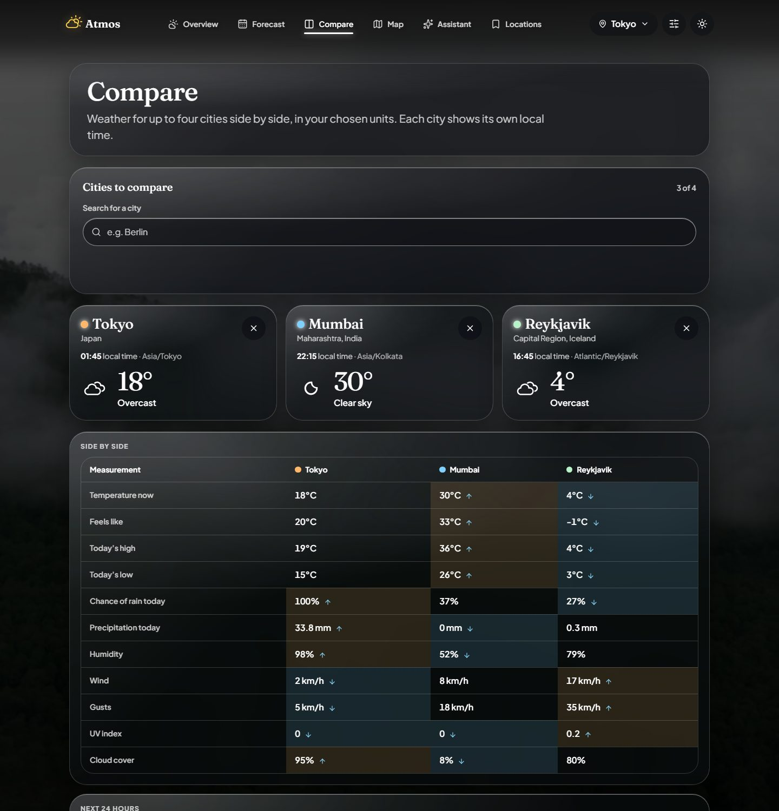
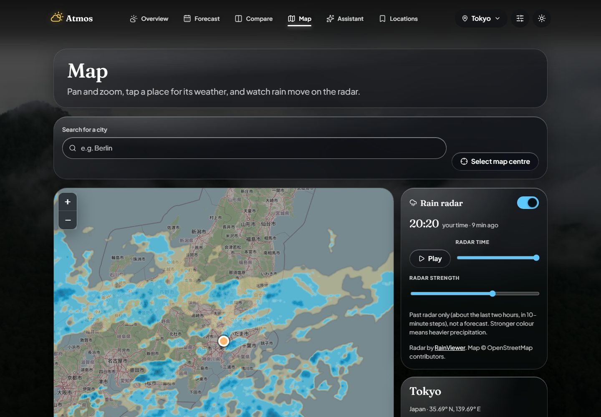
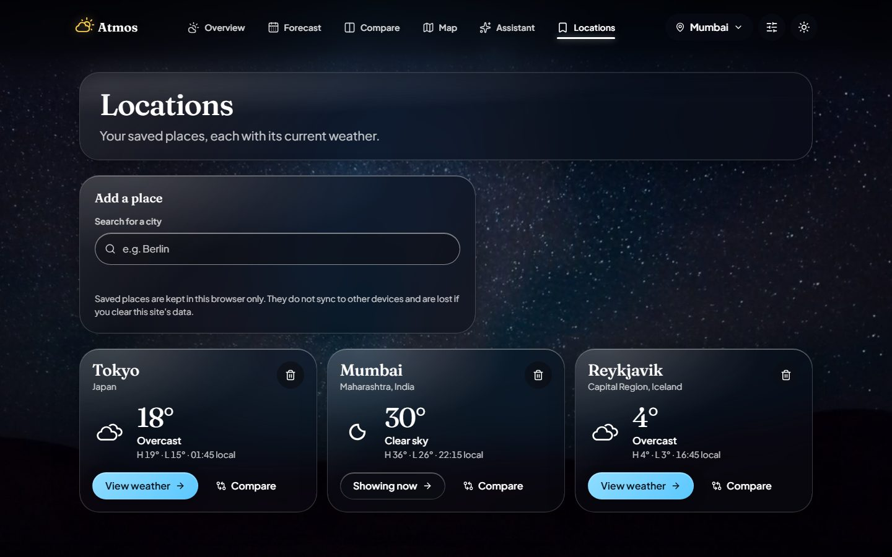
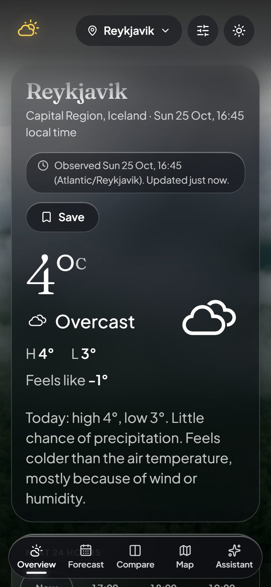

# Atmos

A weather app built as a portfolio project. A looping video of real weather fills the screen behind a liquid-glass interface, and every page shows its data with charts, rings and maps rather than plain numbers.

| | |
|---|---|
|  |  |
|  |  |
|  |  |

## What it does

- **Overview:** current conditions, a 24-hour strip, and widgets for wind, UV, humidity, pressure, visibility, sun, air quality and more, in °C/°F and km/h or mph.
- **Forecast:** an explorer chart for temperature, rain, wind and more, plus 10-day tables.
- **Compare:** two to four cities side by side, each with its own local time, a highest/lowest table, and a 24-hour chart. One city failing never hides the others.
- **Map:** Leaflet on OpenStreetMap with a live RainViewer rain-radar overlay (time slider, play, strength), tap-to-select, and saved places as markers.
- **Locations:** saved places with live mini-forecasts, kept in this browser only.
- **Assistant:** plain-language questions answered from the forecast on screen, by an AI model behind a server endpoint (see below).
- Light and dark themes, a phone layout with a fixed five-tab bar, keyboard and screen-reader support, and reduced-motion support.

## Quick start

Needs Node 22 or newer.

```bash
cd frontend
npm install
npm run dev          # live weather from Open-Meteo, no key needed
```

Other modes:

```bash
npm run dev:snapshot     # recorded forecasts only, no network for weather
npm run build            # production build into frontend/dist
npm run build:snapshot   # production build that serves the recorded forecasts
npm run preview          # serve the build locally
```

## Checks

```bash
npm run format:check   # Prettier
npm run lint           # ESLint (including accessibility rules)
npm run typecheck      # TypeScript, strict
npm test               # 400+ unit and component tests (Vitest)
npm run test:e2e       # end-to-end and accessibility tests (Playwright + axe), against the snapshot build
```

The end-to-end tests use the Chrome installed on your machine. `.github/workflows/ci.yml` runs all of the above; it has not been run on GitHub yet.

## Where the data comes from

| Data | Source | Notes |
|---|---|---|
| Weather, air quality, place search | [Open-Meteo](https://open-meteo.com) (CC BY 4.0), place names from GeoNames | Keyless, called from the browser. Free for non-commercial use. |
| Map | [OpenStreetMap](https://www.openstreetmap.org/copyright) standard tiles | Visible attribution; best-effort availability, so heavy traffic could be blocked. |
| Rain radar | [RainViewer](https://www.rainviewer.com) past radar | Free for personal and educational use, zoom 7, about the last two hours. Not a forecast. |
| Background video | Eight clips from [Mixkit](https://mixkit.co) (Stock Video Free License) | See `atmos-project-docs/docs/CREDITS.md` and the licensing note below. |
| Fonts | Plus Jakarta Sans and Fraunces (SIL Open Font License) | Self-hosted. |

### Live API or recorded snapshots

The app can run on the live Open-Meteo API or on forecasts recorded into `frontend/public/snapshots/` (12 cities, about 190 KB). A recorded forecast is always labelled "Recorded snapshot" with its capture date, never shown as live. `npm run snapshots:record` re-records them. Both code paths stay in the repo; `VITE_DATA_SOURCE=live|snapshot` chooses one at build time. This lets a public deployment keep working after a live-API trial ends.

## The AI assistant

The assistant is a small server endpoint (`frontend/server/assistant/`). The browser sends the question plus a text version of the forecast it is showing; the model is instructed to use only those numbers, to hedge forecasts, to refuse off-topic requests, and to send people to official sources for warnings. The app itself shows a fixed emergency notice beside emergency-sounding questions. Keys never reach the browser, and the assistant is **off unless it is configured**: the page then says so plainly and offers no chat box.

Two providers sit behind one interface:

- **Cloudflare Workers AI** (default): a free daily allowance (10,000 neurons, a few hundred questions). On the free Workers plan it stops at the limit instead of billing.
- **Anthropic** (paid, optional): Claude Haiku 5.5.

For local use, create `frontend/.env.local` (git-ignored):

```
ASSISTANT_ENABLED=true
CLOUDFLARE_ACCOUNT_ID=your-account-id
CLOUDFLARE_API_TOKEN=your-workers-ai-token
```

All settings are listed in `frontend/.env.example`.

## Deploying

`frontend/wrangler.jsonc` describes a Cloudflare Workers deployment: static files with single-page-app fallback, the endpoint at `/api/assistant`, and the Workers AI binding (no key needed). **This has not been deployed or run on Cloudflare yet**; try `npx wrangler dev` first. Any static host works for the site without the assistant. Do not set a Referrer-Policy that removes the Referer header, because OpenStreetMap requires it.

## How it is built

React 19, TypeScript (strict), Vite, CSS Modules with CSS custom properties, TanStack Query, React Router, Recharts, Leaflet, Motion, Zod. No Tailwind.

- `src/lib/api`: a `WeatherDataSource` interface with live and snapshot implementations. Provider payloads are validated with Zod and turned into app-owned metric types; missing values are `null`, never zero.
- `src/features/*`: one folder per page (overview, forecast, comparison, weather-map, locations, assistant).
- `src/components`: shared UI (glass panels, ring gauges, segmented control, anchored panels).
- `src/lib/storage`: versioned, validated local storage that recovers from corrupted data.
- `server/`: the assistant endpoint as a plain `Request` to `Response` function, run by the Vite dev server and by the Cloudflare Worker.

Design and decision records are in `atmos-project-docs/` (`TRD.md`, `DESIGN_SPEC.md`, `OPEN_DECISIONS.md`, `PROVIDER_VALIDATION.md`).

## Known limitations

- **Snapshots cover 12 cities.** In snapshot mode other places, and pins dropped on the map, show "no data for this place".
- **The assistant has not been tried with a real model by the author at the time of writing**, and its per-visitor rate limits are in memory per running instance, so on Cloudflare they are a best-effort guard. The free plan's hard stop is the cost protection.
- **Radar is past data only**, limited to zoom 7 and about two hours.
- **A tapped map point is named by its coordinates**, because Open-Meteo has no reverse geocoding.
- **Backdrop video licensing.** The eight clips are free to use commercially without attribution under Mixkit's licence, which forbids reselling them in their original form. Keeping the raw files in a public repository is a grey area; read the licence at https://mixkit.co/license/ before publishing, or host the videos outside git.
- **Text over moving video** cannot be checked automatically for contrast; it was checked by eye in both themes.
- Tested on current Chrome. Safari and Firefox have not been tried, and the phone tab bar has not been checked on a real iPhone.

## Credits

See `atmos-project-docs/docs/CREDITS.md`.
